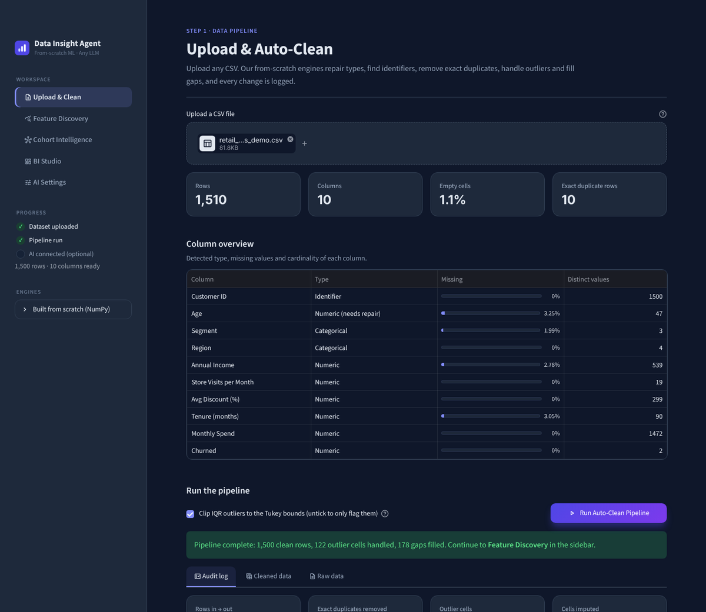
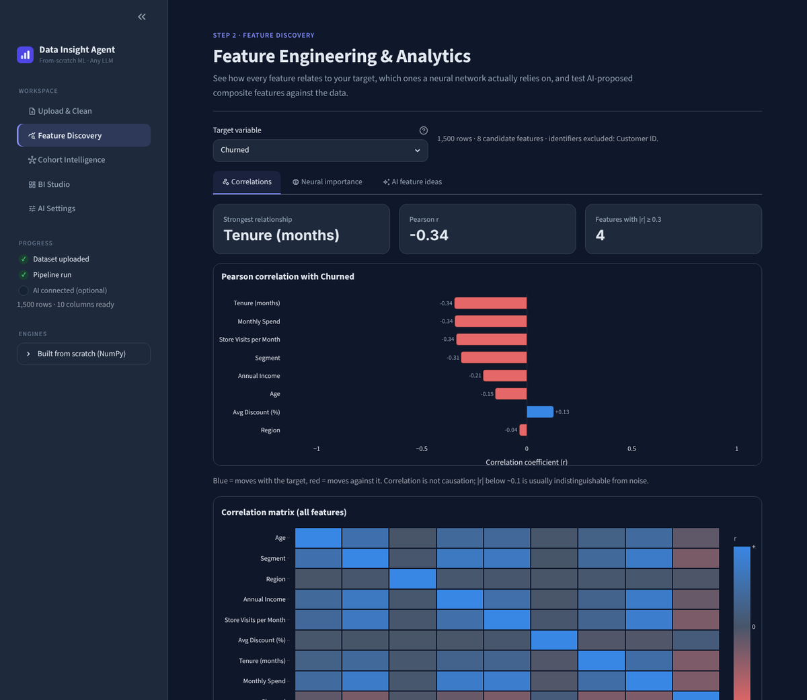
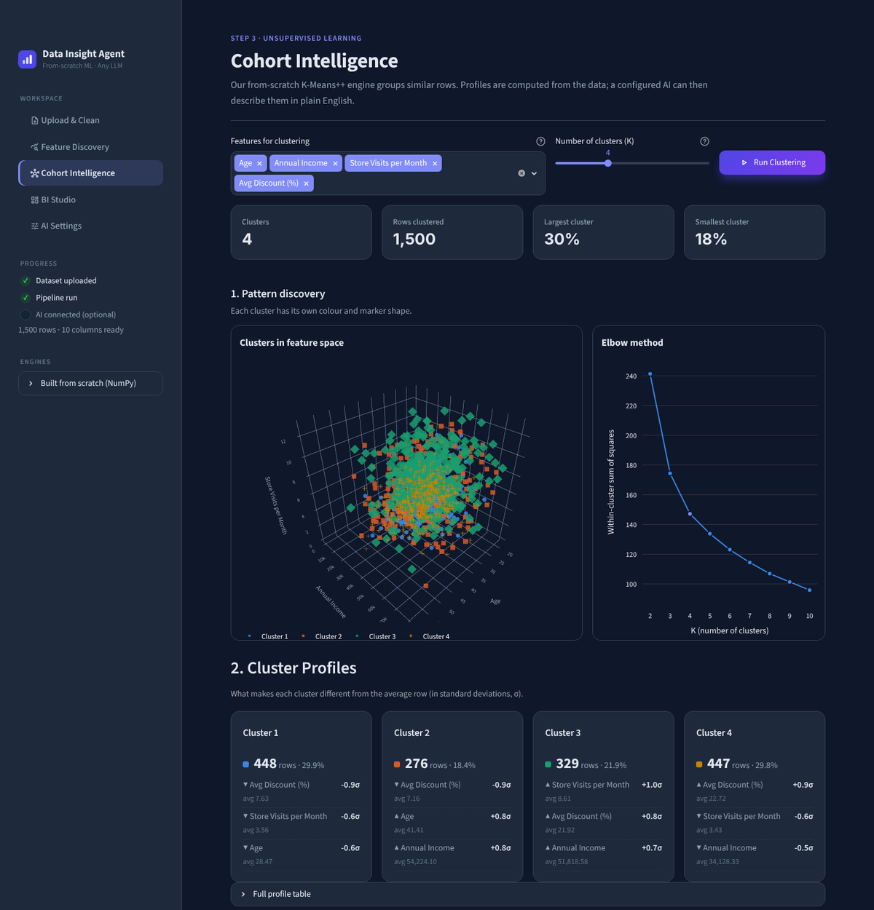
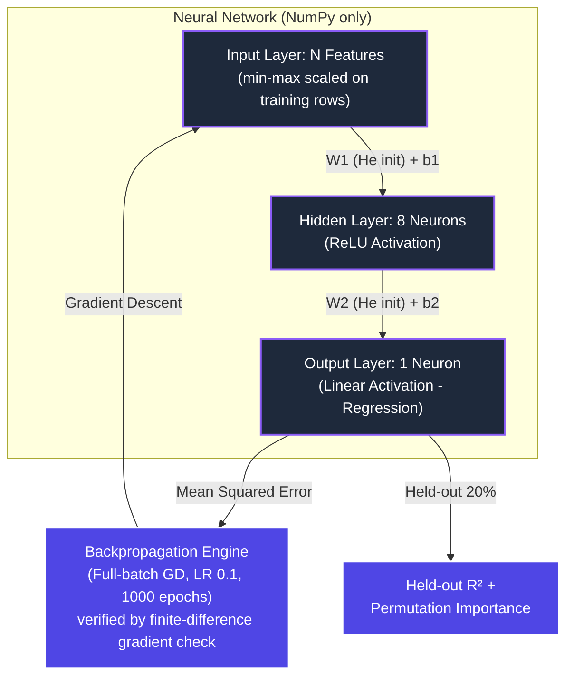
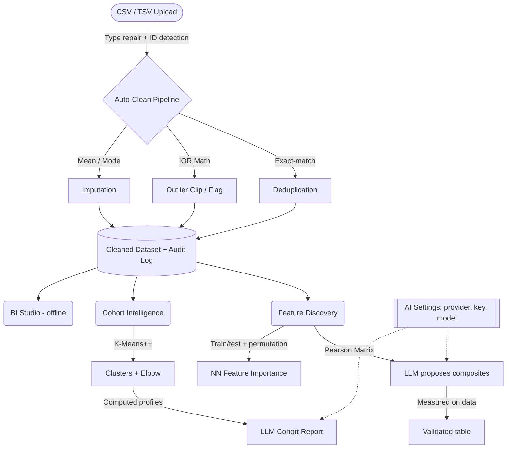

#  Data Insight Agent

An AI-assisted data analysis app built on Streamlit.

This is not a wrapper around existing data science libraries. The core mathematical engines (Neural Network, K-Means++ Clustering, Pearson Correlation, IQR Outlier Detection) are engineered **from scratch** in Python and NumPy, and are verified against NumPy, Pandas and scikit-learn in an automated test suite.

These engines are paired with a **large language model of your choice** (Groq, OpenAI, Google Gemini, Anthropic Claude, or any OpenAI-compatible host, using your own API key). The model interprets results the engines have already computed: it proposes composite features (which the app then measures on your data) and writes cohort reports from computed cluster statistics. **Every analytical feature works without an API key**; only the written AI narratives need one.

---

## 📸 Screenshots

*All screenshots use the bundled synthetic demo file `data/demo/retail_customers_demo.csv`.*

| Upload & Auto-Clean | Feature Discovery |
|---|---|
|  |  |



---

## 🚀 Key Features & Architecture

### 1. Universal Data Pipeline
Upload any CSV or TSV file (the separator is chosen from the extension). The pipeline detects numeric, categorical and identifier columns, cleans the data, and records every change in an **audit log** shown in the app.
- **Type repair**: text columns that are at least 80% numeric are converted to numbers (junk such as `"UNKNOWN"` becomes missing).
- **Identifier detection**: columns like `Patient ID` are kept but excluded from cleaning and analysis.
- **Outlier Detection**: Tukey IQR bounds computed from scratch (linear-interpolated quartiles). Outliers are clipped to the bounds by default, or only flagged if you untick the option, since extreme values are not always errors.
- **Imputation**: numeric gaps are filled with the column mean, categorical gaps with the mode.
- **Deduplication**: only rows identical in *every* column are removed. Rows that differ only by their ID are reported but **not** merged, because identical-looking records are not assumed to be the same entity.
- The original upload is never modified, and the cleaned CSV can be downloaded.

### 2. Feature Engineering & Discovery
- **Pearson Correlation Engine**: the full covariance / standard-deviation correlation matrix computed from scratch with vectorised NumPy (7-31x faster than the original double loop, identical to `np.corrcoef` within 1e-15).
- **Neural Network Feature Importance**: the from-scratch network is trained on 80% of rows and scored on the held-out 20%. Scaling is fitted on the training rows only, so there is no leakage. Importance is **permutation importance**: how much held-out error rises when a feature is shuffled. The app shows held-out and training R² and warns when the model has no predictive power.
- **AI Synthesis (optional)**: your chosen LLM reads the exact correlations and proposes composite features. The app then **measures** each proposal (the |r| of an equal-weight z-scored composite against its best component) and rejects column names the model invented. The LLM never supplies numbers.

### 3. Cohort Intelligence (Unsupervised Learning)
- **K-Means++ from scratch**: K-Means++ seeding, multiple restarts, vectorised Euclidean distances and empty-cluster recovery. You choose K, guided by an **elbow (WCSS) chart**.
- **Computed cluster profiles**: size, share, per-cluster means and most common categories.
- **AI report (optional)**: the LLM receives only the computed profile table and is instructed not to invent statistics.

### 4. Native Business Intelligence Studio
Tableau/Power BI-style drag-and-drop exploration via PyGWalker, running in **offline privacy mode** (no telemetry).

### 5. AI Settings: Bring Your Own Key
Pick a provider, paste a key (or load it from `.env`), fetch the live model list, test the connection, and switch or clear at any time. See [Configuring AI providers](#-configuring-ai-providers).

---

## 🧠 System Architecture Diagrams

### From-Scratch Neural Network Engine
*Used for predictive modelling and permutation feature importance.*



### Full Application Data Flow
*How the mathematical engines interact with the optional LLM layer.*



---

## 💻 Tech Stack
- **Frontend**: Streamlit (Enterprise Slate CSS theme)
- **Backend & Math**: Python, NumPy, Pandas
- **Visualization**: Plotly Express (3D scatters, bar and elbow charts)
- **Generative AI**: any provider via the `openai` SDK's OpenAI-compatible interface (Groq, OpenAI, Gemini, Claude, custom)
- **BI Tools**: PyGWalker
- **Testing**: pytest (+ scikit-learn as a reference implementation in tests only)

---

## 🛠️ Installation & Usage

1. **Clone the repository**
   ```bash
   git clone https://github.com/sheetalll28/data-insight-agent.git
   cd data-insight-agent
   ```

2. **Create and activate a virtual environment** (Python 3.10+)
   ```bash
   python3 -m venv env
   source env/bin/activate
   pip install -r requirements.txt
   ```

3. **(Optional) Add API keys**: copy `.env.example` to `.env` and fill in the keys you want. You can also paste a key in the app's **AI Settings** page instead. `.env` is git-ignored and must never be committed.

4. **Run the Application** (from the project root, so the dark theme in `.streamlit/config.toml` is picked up)
   ```bash
   streamlit run src/app.py
   ```
   A demo file with real patterns is included: upload `data/demo/retail_customers_demo.csv` (synthetic data).

5. **Run the tests**
   ```bash
   pip install -r requirements-dev.txt
   pytest -q
   ```
   The suite (61 tests) needs no API keys or network access: every LLM call is mocked.

---

## 🔑 Configuring AI providers

| Provider | Key from | `.env` variable | Notes |
|---|---|---|---|
| Groq | console.groq.com/keys | `GROQ_API_KEY` | Default model `openai/gpt-oss-120b` (`llama-3.3-70b-versatile` was retired by Groq on 16 Aug 2026) |
| OpenAI | platform.openai.com/api-keys | `OPENAI_API_KEY` | Needs API billing; a ChatGPT subscription does not include API access |
| Google Gemini | aistudio.google.com/apikey | `GEMINI_API_KEY` | Uses Gemini's OpenAI-compatible endpoint |
| Anthropic Claude | platform.claude.com/settings/keys | `ANTHROPIC_API_KEY` | Uses Anthropic's OpenAI-SDK compatibility layer |
| Custom (OpenAI-compatible) | your provider | `LLM_API_KEY` | Set a base URL, e.g. OpenRouter, Together AI, or a self-hosted server |

In **AI Settings**: choose the provider, paste the key (or leave it blank to use `.env`), click **Fetch models** or type a model ID, then **Save** and **Test connection**. Model names change often, so fetch the live list rather than relying on defaults.

**Security notes**
- A key typed into the app lives only in that browser session's server memory. It is not written to disk, logged, or shown back, and it is scrubbed from error messages. Session memory is not a secrets vault, so use `.env` or your host's secret manager for anything long-lived.
- Only aggregated statistics (correlation coefficients, cluster means and sizes, column names) are sent to the provider, never raw rows. Column names themselves may be sensitive, so bear that in mind.
- Requests time out (60 s by default) and transient failures (429 and 5xx) are retried with exponential backoff; authentication errors are not retried.

---

## 🔬 Standalone research scripts (`src/`)

These scripts reproduce the project's original experiments on the bundled mental-health dataset. `corrupt_data.py` injects known errors and writes an answer key (`data/processed/ground_truth.json`). They are not part of the Streamlit app.

| Script | What it does | Current result |
|---|---|---|
| `outlier_detection.py` | IQR outlier flags vs the answer key | Precision 0.967 · Recall 0.921 · F1 0.943 |
| `dedup_from_scratch.py` | Levenshtein + weighted similarity + Union-Find entity resolution (O(n²), ~25 s) | Precision 0.846 · Recall 1.000 · F1 0.917 |
| `impute_missing_values.py` | NN imputation of missing `Age` vs a mean baseline | NN RMSE 14.36 vs baseline 12.83: **the baseline wins** (see below) |
| `kmeans_from_scratch.py` | Elbow method on the dataset | WCSS for K = 2..10 |
| `nn_from_scratch.py` | Finite-difference gradient check | Passes (relative error < 1e-7) |
| `levenshtein.py` | Edit-distance self-test | 5/5 |

**Honesty note on the bundled dataset:** its features carry almost no predictive signal. On held-out data both the neural network and plain linear regression score R² ≤ 0 for targets such as `Age`, `Treatment Progress` and `Adherence`. An earlier version of `impute_missing_values.py` reported that the network beat the baseline, but only because the baseline was averaged over unclipped ages containing injected values such as 999. The comparison is now fair. On data with real signal the network performs well (held-out R² 0.95 on the synthetic benchmark in `tests/`).

---

## ⚠️ Known limitations

- The neural network is a single-hidden-layer **regression** model trained with full-batch gradient descent. Categorical targets are label-encoded and treated as numbers, which gives only a rough trend.
- Pearson correlation measures linear association only. Label-encoded categorical columns give order-dependent coefficients, and no significance testing or multiple-testing correction is applied.
- AI composite-feature gains are measured on all rows (exploratory), not on a held-out split.
- Clustering uses min-max scaling and label-encoded categories, so Euclidean distance on those codes is a rough measure.
- Very large CSVs are held in memory. Charts are sampled (3,000 to 5,000 points), but the pipeline itself is not chunked.


